# Little Muffin | 綴歌・瑪芬

全年齡戀愛視覺小說（galgame）。女主角是性轉版的跩哥・馬份「**綴歌・瑪芬**」，玩家扮演哈利，舞台是《哈利波特》原著第 6 學年的 IF 世界線。
用 [Ren'Py](https://www.renpy.org/) 8.5.3 製作，1920×1080。支援繁體中文、日文（第一次啟動時選擇語言，之後可以在「設定 → 語言」切換）。

**本作為非官方同人作品，與《哈利波特》原作者及版權方無關，僅供免費、非商業交流。**

| 標題畫面 | 人物對話 | CG鑑賞 |
|:---:|:---:|:---:|
|  | 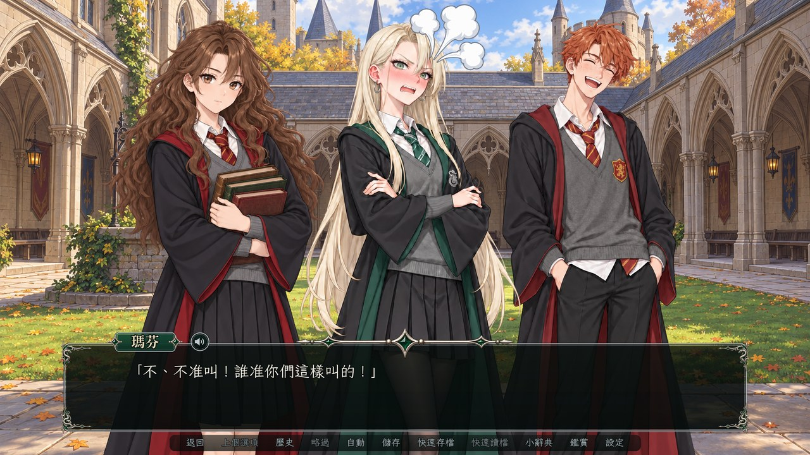 | 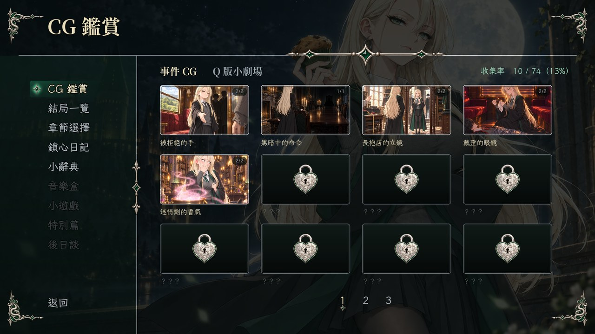 |
| **專用CG** | **劇情立繪** | **後日談（泳裝回）** |
| 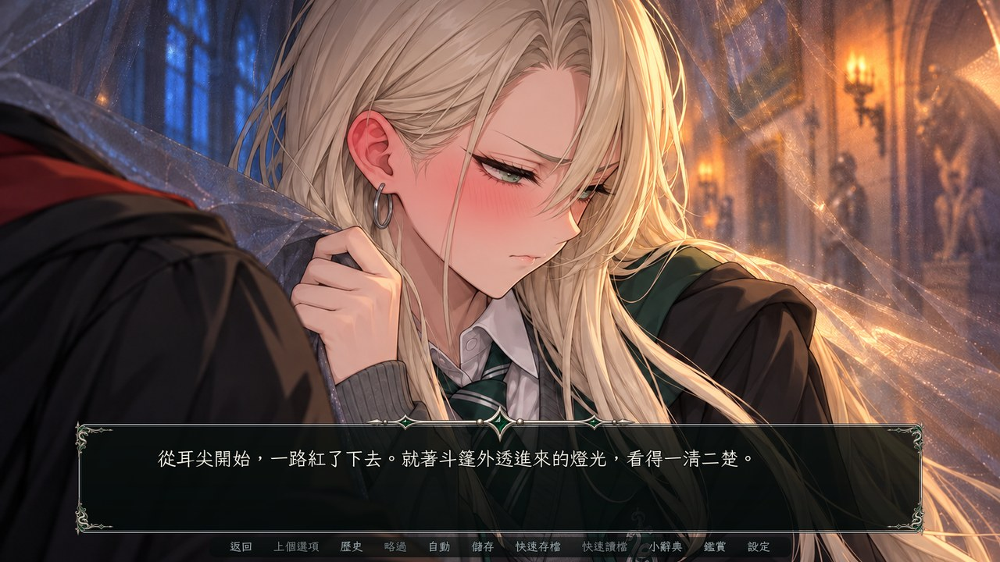 | 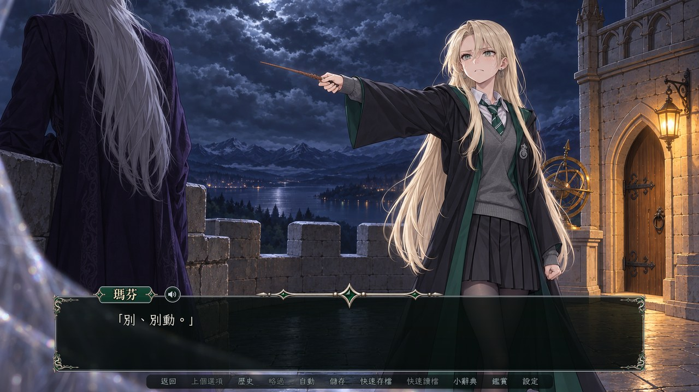 | 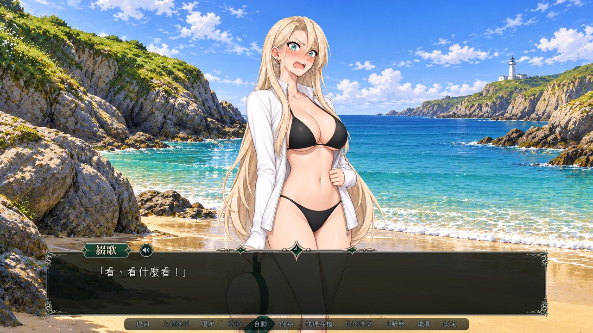 |

## 遊戲內容

- 序章～終章共 12 章，約 11 萬字。第一輪約 4～5 小時，看完全部結局約 7 小時。
- 五個結局：真結局、苦甜結局、原著結局、壞結局、搞笑結局。選項、好感度（心動）、信任與良知會決定走向。
- 章末的「心鎖」顯示她對你的信任；每章一頁她視角的「鎖心日記」。
- 「妙麗的小辭典」：哈利波特名詞第一次出現時點一下就有白話說明，沒看過原著也能玩。
- 特典：CG 鑑賞（含回想）、結局一覽、章節選擇、鎖心日記；真結局通關後解鎖特別篇與後日談（泳裝回）。

## 安裝教學

1. 到右邊的 [**Releases**](https://github.com/k22949706/LittleMuffin/releases) 下載最新版的 zip（約 230 MB，含音樂與音效）。
2. 解壓縮到任意資料夾。路徑裡有中文也沒關係。
3. 打開解壓出來的 `LittleMuffin` 資料夾，雙擊 **`LittleMuffin.exe`** 開始遊戲。

不需要安裝任何東西。Windows 第一次執行時如果跳出「Windows 已保護您的電腦」，按「其他資訊 → 仍要執行」。

## 製作

| 職務 | |
|---|---|
| 原案・企劃、專案管理 | ケニー |
| 劇本、世界觀・角色設定 | Claude Code Opus 5.5 |
| 美術指導（提示詞設計・審圖）、影像後製、UI 設計 | Claude Code Opus 5.5 |
| 美術繪製（立繪・CG・背景・Q 版・UI 素材） | Codex GPT-6.1 Sol |
| 音樂・音效（選曲・編輯）、程式 | Claude Code Opus 5.5 |
| 測試 | ケニー、Claude Code Opus 5.5 |

## 出處

- **原作**：J.K. Rowling《哈利波特》系列。人名、地名、咒語採用皇冠出版社繁體中文版譯名。
- **引擎**：Ren'Py 8.5.3（MIT License 等，見 Ren'Py 的授權說明）。
- **字型**（SIL Open Font License 1.1，授權檔隨遊戲附在 `game/fonts/`）：霞鶩文楷 TC（LXGW WenKai TC）、源流明體（GenRyuMin2 TW）、辰宇落雁體（ChenYuluoyan）、Cinzel Decorative（英文標題）；日文版另用 Klee One、源流明朝（GenRyuMin2 JP）、Yomogi。
- **音樂**：OpenTracks（舊 DOVA-SYNDROME）、甘茶の音楽工房、PeriTune「Rosa_Nera」（CC BY 4.0）。
- **音效**：効果音ラボ、ポケットサウンド（https://pocket-se.info/）。
- 各曲的作者與曲名列在遊戲的「關於」畫面和片尾名單。
- 美術由 Codex GPT-6.1 Sol 以 AI 生成，再經審圖與後製。

---

# Little Muffin | ドラコニア・マフィン

全年齢向けの恋愛ビジュアルノベル（ギャルゲー）です。ヒロインは、ドラコ・マルフォイの性別を反転させた女の子「**ドラコニア・マフィン**」。舞台は『ハリー・ポッター』原作の6年生の1年をもとにしたIFの世界線で、プレイヤーはハリーとなってその1年を過ごします。
[Ren'Py](https://www.renpy.org/) 8.5.3 で制作、解像度は1920×1080。日本語・繁体字中国語に対応しています（初回起動時に言語を選べます。あとから「設定 → 言語」で切り替えることもできます）。

**本作は非公式の二次創作作品であり、『ハリー・ポッター』の原作者および権利者とは一切関係ありません。無料・非営利で公開しています。**

| タイトル画面 | キャラクター会話 | CG鑑賞 |
|:---:|:---:|:---:|
| 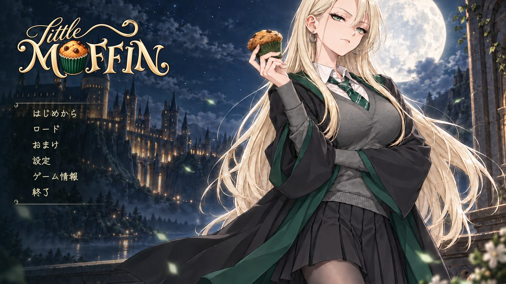 | 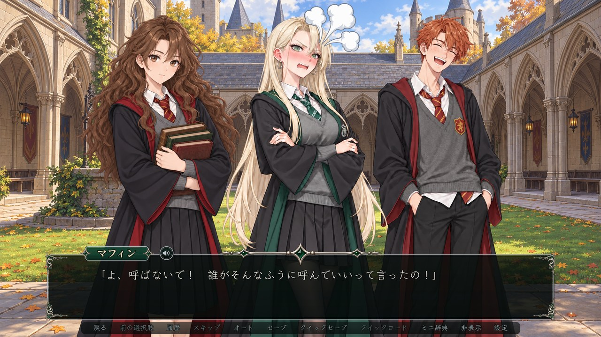 | 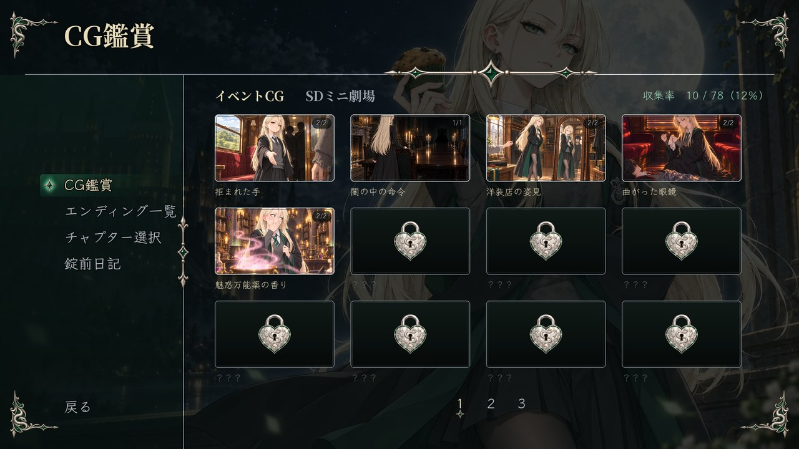 |
| **専用CG** | **ストーリー立ち絵** | **後日談（水着回）** |
| 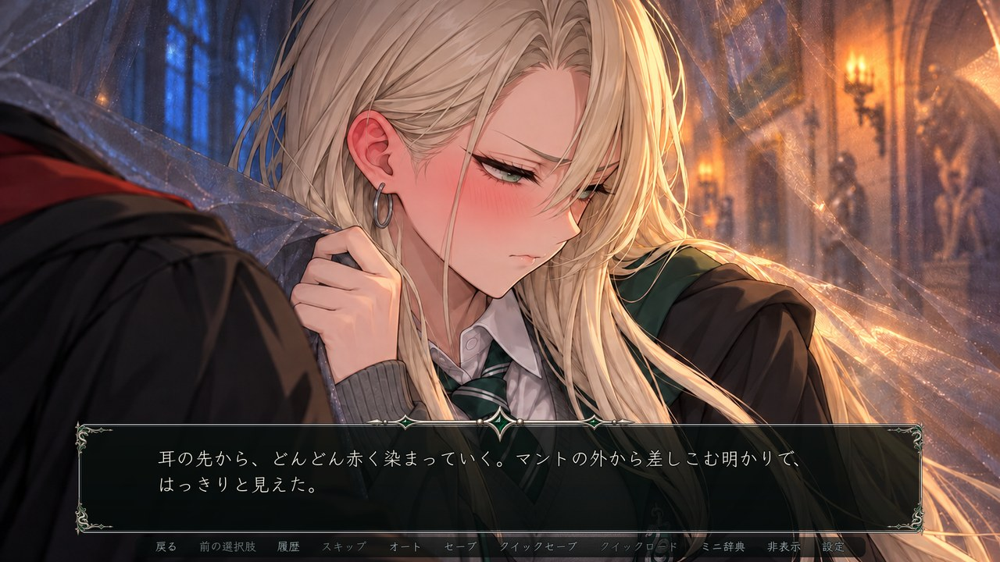 | 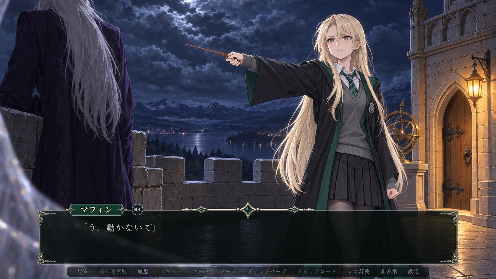 | 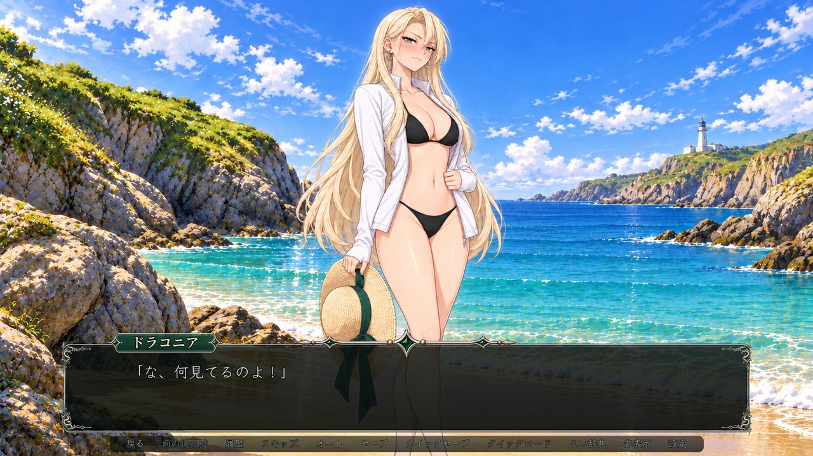 |

## ゲーム内容

- 序章〜終章の全12章、日本語版で約17万字。1周目は4〜5時間ほど、すべてのエンディングを見るまで約7時間です。
- エンディングは5種類：トゥルーエンド、ほろ苦エンド、原作エンド、バッドエンド、ジョークエンド。選択肢と、好感度（ときめき）・信頼・良心のパラメータで行き先が変わります。
- 章の終わりに出てくる「心の錠前」は、彼女があなたをどれだけ信頼しているかのしるし。各章に1ページずつ、彼女の視点で書かれた「錠前日記」もあります。
- 「ハーマイオニーのミニ辞典」：『ハリー・ポッター』の用語が初めて出てきたときにクリックすると、やさしい解説が読めます。原作を知らなくても楽しめます。
- おまけ：CG鑑賞（回想つき）、エンディング一覧、チャプター選択、錠前日記。トゥルーエンドをクリアすると、特別編と後日談（水着回）が解放されます。

## インストール方法

1. 右側の [**Releases**](https://github.com/k22949706/LittleMuffin/releases) から最新版のzipをダウンロードします（約 230 MB、BGM・効果音を含みます）。
2. 好きなフォルダに展開します。フォルダのパスに日本語が入っていても大丈夫です。
3. 展開してできた `LittleMuffin` フォルダを開き、**`LittleMuffin.exe`** をダブルクリックするとゲームが始まります。

インストール作業は必要ありません。初回起動時に「Windows によって PC が保護されました」と表示された場合は、「詳細情報 → 実行」を押してください。

## スタッフ

| 担当 | |
|---|---|
| 原案・企画、プロジェクト管理 | ケニー |
| シナリオ、世界観・キャラクター設定 | Claude Code Opus 5.5 |
| アートディレクション（プロンプト設計・画像チェック）、画像加工、UIデザイン | Claude Code Opus 5.5 |
| グラフィック（立ち絵・CG・背景・SD・UI素材） | Codex GPT-6.1 Sol |
| 音楽・効果音（選曲・編集）、プログラム | Claude Code Opus 5.5 |
| テスト | ケニー、Claude Code Opus 5.5 |

## クレジット

- **原作**：J.K.ローリング『ハリー・ポッター』シリーズ。本作の人名・地名・呪文などの表記は、静山社版の日本語訳にならっています。
- **エンジン**：Ren'Py 8.5.3（MIT License ほか。詳しくは Ren'Py のライセンス表記をご覧ください）。
- **フォント**（SIL Open Font License 1.1。ライセンス文はゲームの `game/fonts/` に同梱）：日本語版は Klee One、源流明朝（GenRyuMin2 JP）、Yomogi。繁体字中国語版は霞鶩文楷 TC（LXGW WenKai TC）、源流明體（GenRyuMin2 TW）、辰宇落雁體（ChenYuluoyan）。英語タイトルは Cinzel Decorative。
- **音楽**：OpenTracks（旧 DOVA-SYNDROME）、甘茶の音楽工房、PeriTune「Rosa_Nera」（CC BY 4.0）。
- **効果音**：効果音ラボ、ポケットサウンド（https://pocket-se.info/）。
- 各曲の作者名と曲名は、ゲーム内の「クレジット」画面とエンディングのスタッフロールに記載しています。
- グラフィックは Codex GPT-6.1 Sol による AI 生成です。生成した画像はチェックと加工を経て使用しています。
